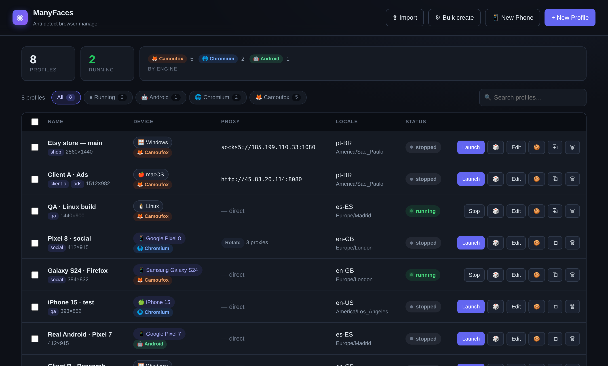

<p align="center">
  
</p>

<h1 align="center">ManyFaces</h1>

<p align="center">A local browser profile manager for keeping accounts and test environments separate.</p>

<p align="center">
  <a href="#quick-start">Quick start</a> ·
  <a href="#browser-engines">Browser engines</a> ·
  <a href="#build-and-package">Build and package</a> ·
  <a href="#development">Development</a>
</p>



ManyFaces keeps browser storage, proxy settings, and device settings per profile.
Use it for accounts you manage, browser QA, and testing across devices and regions.
Follow the rules of the sites you access.

## Quick start

Install the Python dependencies and start the dashboard on Windows, Linux, or macOS.

```sh
python -m pip install -r requirements.txt
python run.py
```

The dashboard opens in your default browser. Use `python run.py --no-open` to start
the server without opening a tab. You can also launch it with `START.bat` on
Windows or `./start.sh` on Linux and macOS.

For a desktop window, run `python desktop.py`. It uses pywebview and requires
WebView2 on Windows or a supported WebView backend on Linux and macOS.
Browser mode works without a desktop WebView.

## Browser engines

Choose an engine when creating or editing a profile.

| Engine | Use it for | First-time setup |
| --- | --- | --- |
| Camoufox | Firefox profiles with saved fingerprint settings | Select **Download engine** in the dashboard or run `python -m camoufox fetch`. |
| Chromium | Chromium compatibility and emulated phone profiles | Run `python -m playwright install chromium`. |
| Android | Chrome inside an Android emulator | Select **New phone → Android emulator → Create & boot** and follow the setup prompt. |

Camoufox requires 0.5.9 or newer in the 0.5.x series, as specified in
[requirements.txt](requirements.txt).
The dashboard works before an engine is installed.

Android setup downloads the SDK, a system image, and the scrcpy mirror.
Hardware virtualization improves boot and rendering performance. Allow roughly
4–5 GB per Android profile. Android proxy settings support unauthenticated
HTTP/HTTPS proxies.

## Work with profiles

- **Create and launch.** Use **New profile**, **New phone**, or **Bulk create**.
  Phone profiles can use Chromium emulation or the Android emulator.
- **Find profiles.** Search by name, tag, note, device, timezone, or proxy host.
  Filter by status or engine and sort by name, creation, or last update. The
  dashboard remembers your filter and sort choices in the current browser.
- **Manage profiles.** Launch, stop, or edit a profile from its row. **More**
  contains cookie tools, cloning, randomization, and deletion. On smaller
  screens, each profile appears as a card with the same controls.
- **Configure proxies.** Set one HTTP, HTTPS, or SOCKS5 proxy, or paste a pool
  and select random or round-robin assignment. Test a proxy or pool before launch.
- **Move settings.** Select profiles and choose **Export**, then use **Import**
  to restore the JSON. Export includes settings, fingerprint data, proxy
  credentials, and staged cookies. Treat it as sensitive. Browser history,
  logins stored by the browser, and caches stay with the local profile.

Metadata lives in `~/.antidetect/antidetect.db`, with browser data under
`~/.antidetect/profiles/`. Set `ANTIDETECT_DATA_DIR` to use a different directory.

## Build and package

Build on the target operating system.

```sh
python -m pip install pyinstaller
pyinstaller build.spec --noconfirm
```

The standalone app downloads Camoufox on demand. To distribute it with
Camoufox bundled, install the engine and build the portable archive.

```sh
python -m camoufox fetch
python package_portable.py
```

Extract `dist/ManyFaces-Portable.zip` and keep the `browser/` directory next to
the executable. The bundled Camoufox binary is specific to the build platform.

## Troubleshooting

- Select **Failed** on a profile to see its launch error. More detail is
  available in `~/.antidetect/error.log`.
- On Linux, Camoufox renders the window at the profile's display scale. If
  it exceeds the work area, ManyFaces can reduce a desktop window within its
  supported size range. Phone windows keep their preset dimensions. Use
  **Fit this display** when creating a Camoufox desktop profile to select a
  compatible preset. If none fits, choose another OS or turn off the option.
- For a profile that needs a larger display, use Chromium for interactive
  phone emulation or Camoufox's **Launch in virtual display** for automation.
  Virtual display mode needs Xvfb and `setpriv` on Linux. Camoufox's Xvfb
  uses software rendering and disables X11 access control. Use it on a
  machine without untrusted local users.
- If Chromium is missing, run `python -m playwright install chromium` in the
  same Python environment that runs ManyFaces.
- Stop a running profile before editing or randomizing it.
- For Android setup and boot errors, check the installer log in the dashboard
  and confirm virtualization is enabled on your machine.

## Development

The dashboard is in [web/](web/). The FastAPI server, profile storage, and
engine integrations are in [antidetect/](antidetect/). The server exposes
interactive API documentation at `/docs`.

```sh
python -m unittest discover -s tests -v
node --check web/app.js
```

To include the Chromium dashboard check, install the Playwright browser and
set `MANYFACES_BROWSER_TESTS=1` before running the test suite. In PowerShell,
use `$env:MANYFACES_BROWSER_TESTS = '1'`. The browser test writes screenshots
to `.testdata/`.

To regenerate the dashboard logo and Windows icon, install Pillow and run
`python assets/make_icon.py`.

### Python automation

Use a saved Camoufox profile from Python. See
[antidetect/automate.py](antidetect/automate.py) for the async entry point.
Use `headless="virtual"` to run on an Xvfb display on Linux.

```python
from antidetect.automate import launch

with launch("<profile-id>", headless=True) as browser:
    page = browser.new_page()
    page.goto("https://example.com")
    print(page.title())
```
